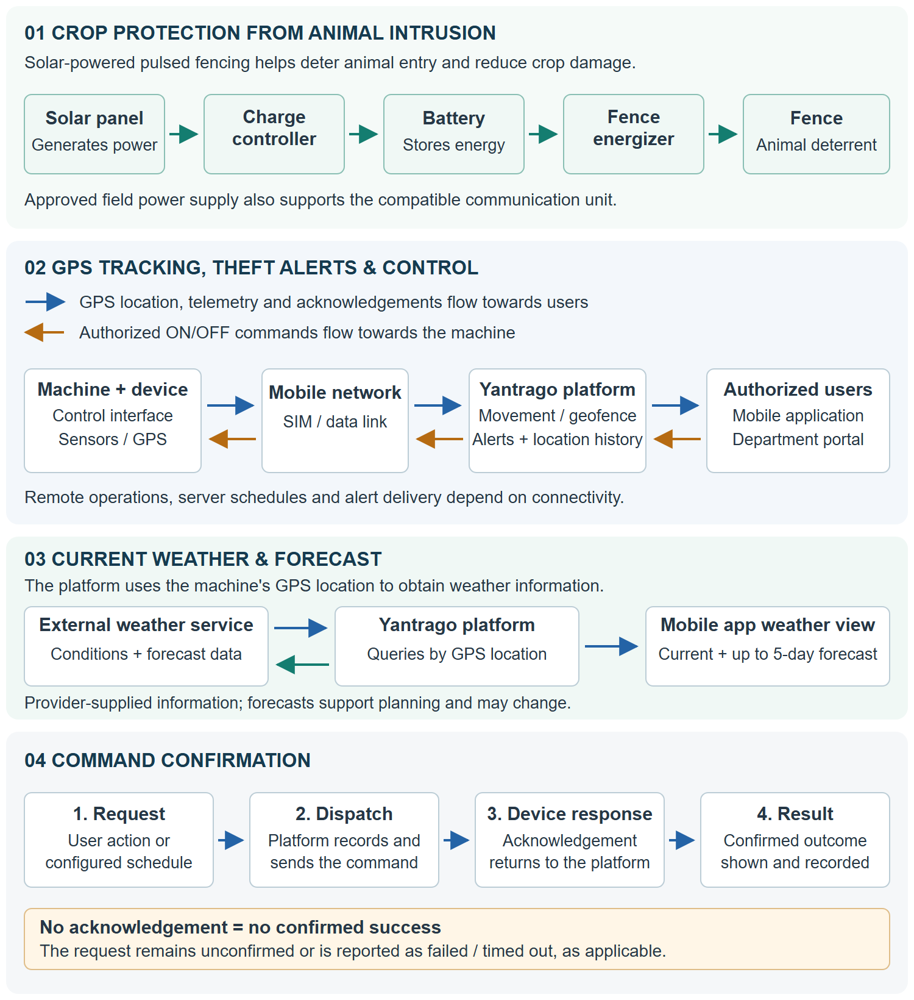

# YANTRAGO FENCE
## Solar-Based Smart Zhatka Machine
### Project Report & Government Procurement Proposal

Crop protection from animal intrusion, with GPS theft protection, remote control and weather forecasts

| Submission particulars | Details |
| --- | --- |
| Submitted by | ELECSTARK AI & POWER SOLUTIONS PRIVATE LIMITED |
| CIN | U26109ME2026PTC475027 |
| GSTIN | 27AAJCE7337A1ZR |
| Company address | Plot No. 145, New Mahalgi Nagar, Near Gajanan Temple, Nagpur - 440034 |
| Mobile | +91 9175330150 |
| Email | elecstarktech@gmail.com; info@elecstark.com |
| Website | www.elecstark.com |
| Submitted to | [Government department / office] |
| Project location | [Village / block / district / state] |
| Proposed quantity | [Number of machines and sites] |
| Proposal reference | [Reference number] |
| Submission date | [DD Month YYYY] |
| Contact person | [Name and designation] |
| Document version | 1.0 — Procurement proposal for review |

**DRAFT FOR REVIEW — COMPLETE BEFORE SUBMISSION**

Bracketed fields require confirmation. Hardware specifications, prices, warranty terms, delivery commitments and certification details must be supported by signed supplier documents before this proposal is submitted.

Prepared for consideration by the competent procuring authority. Supply and award remain subject to the applicable procurement process and agreed technical specifications.

<!-- PAGEBREAK -->
# Letter of Submission

To,
The [Designation of Competent Authority]
[Department / Government Office]
[District, State and Postal Address]

**Subject: Proposal for supply, installation and maintenance of solar-based smart Zhatka machines for crop protection from animal intrusion**

Respected Sir/Madam,

We submit this project report for your consideration for procurement and deployment of Yantrago Fence solar-based smart Zhatka machines at approved agricultural sites in [district/state].

The system's primary purpose is crop protection from animal intrusion through solar-powered pulsed fencing. GPS tracking and movement/geofence alerts support equipment theft protection, while current weather, forecasts and acknowledged remote ON/OFF control help users manage field operations. The mobile application and administration portal provide authorized monitoring and oversight.

The proposed procurement comprises [quantity] machines, site assessment, installation, commissioning, user training and support for [contract period]. Fence wire, posts, civil works and other site-specific items will be included only where explicitly measured and priced in the approved bill of quantities.

We request technical evaluation of the proposed solution, identification of suitable sites and beneficiaries, and consideration for procurement through the procedure applicable to your office. A demonstration and inspection of the offered equipment may be arranged as part of the evaluation.

The final offer will include model-specific technical specifications, applicable test and compliance records, a signed commercial quotation, and agreed service obligations. The enclosed report sets out the proposed scope, implementation approach, acceptance checks and financial framework.

We would be pleased to provide the information required by the department for its technical and financial assessment.

Yours faithfully,

[Signature of authorized signatory]
**[Name and designation]**
For **ELECSTARK AI & POWER SOLUTIONS PRIVATE LIMITED**
Plot No. 145, New Mahalgi Nagar, Near Gajanan Temple, Nagpur - 440034
Mobile: +91 9175330150 | Email: elecstarktech@gmail.com; info@elecstark.com
Website: www.elecstark.com
CIN: U26109ME2026PTC475027 | GSTIN: 27AAJCE7337A1ZR
Date: [DD Month YYYY] | Place: [City]
Company seal: [If required]

Enclosures: Project report, signed quotation, technical datasheet, credentials and applicable test records as listed in Section 12.

<!-- PAGEBREAK -->
# Executive Summary

Yantrago Fence is designed to **help protect crops from animal intrusion** through solar-powered pulsed electric fencing. Major connected features include **GPS tracking for theft protection**, **current weather and forecasts of up to five days**, and acknowledged remote ON/OFF control. Together, these support crop protection, equipment security and field planning.

The procurement objective is to reduce animal-related crop damage, improve equipment visibility and reduce routine switching visits. Crop protection depends on suitable fence design, site conditions, maintenance and animal behaviour; outcomes will be assessed through field records.

| Project parameter | Proposed basis |
| --- | --- |
| Procuring authority | [Department / office] |
| Supplier / project proponent | ELECSTARK AI & POWER SOLUTIONS PRIVATE LIMITED |
| Deployment area and beneficiaries | [Locations, farmer groups and selection criteria] |
| Quantity and measured boundary | [Machines] and [metres of fence, if included] |
| Delivery and support period | [Approved schedule] and [support duration] |
| Procurement value | INR [Amount], supported by the signed quotation |
| Funding source | [Department budget head / approved programme] |
| Requested decision | Technical evaluation and consideration for procurement |

**Basis of the proposal.** Project material and application components support GPS theft protection, current weather, forecasts, remote control, scheduling and multilingual access. Hardware ratings, field performance, compliance and commercial terms require model-specific confirmation. Weather comes from an external provider using the machine's GPS location. This report is not a test certificate or price quotation.

## Report guide

1. Project need, objectives and beneficiaries
2. Proposed system and operating workflow
3. Technical specification schedule
4. Safety, site suitability and compliance
5. Supply scope and responsibilities
6. Implementation and delivery plan
7. Inspection, testing and acceptance
8. Training, warranty and maintenance
9. Administration, data and reporting
10. Financial proposal and lifecycle costs
11. Expected outcomes, monitoring and risks
12. Supplier credentials and submission enclosures
13. Finalization checklist and references

<!-- PAGEBREAK -->
# Product Photograph

<!-- PHOTO_PLACEHOLDER -->

Space reserved for product photograph

<!-- END_PHOTO_PLACEHOLDER -->

**Figure 1. Yantrago solar-based smart Zhatka machine**

Model shown: [Model number]

Components shown and included in the proposed supply: [Complete when the photograph is added]

<!-- PAGEBREAK -->
# 1. Project Need, Objectives and Beneficiaries

## 1.1 Need for the project

Animal entry into cultivated fields can damage crops through feeding and trampling. Solar-powered pulsed fencing is intended to deter entry at the field boundary. When equipment is installed away from the farmer's residence, unnoticed power loss or fence faults can weaken protection and require repeated inspection visits.

A solar-battery supply can support operation where grid access is limited, subject to adequate panel and battery sizing. Connected monitoring adds visibility of reported equipment condition and helps users decide when a field visit is needed. Physical fence inspection, vegetation clearance and local operating procedures remain essential.

## 1.2 Project objectives

- Help protect crops from animal intrusion through appropriately designed and commissioned solar-powered fencing.
- Support theft protection through GPS tracking, location history and configured movement/geofence alerts.
- Display current weather and forecasts for the machine's location to support field planning.
- Enable remote ON/OFF requests and scheduled operation with acknowledgement and traceable command records.
- Notify responsible users of configured abnormal conditions so that they can investigate and respond.
- Establish measurable acceptance, training, maintenance and reporting arrangements for public expenditure.

## 1.3 Intended beneficiaries

Potential beneficiaries include individual farmers, farmer groups, farmer producer organizations, community farm clusters and departmental demonstration farms selected by the procuring authority. The final beneficiary list, ownership arrangements and operating responsibilities must be approved before installation.

## 1.4 Site selection and baseline

The joint site survey should document landholder permission, boundary length and layout, crop pattern, existing fence condition, public access, livestock movement, solar exposure, flood exposure and mobile network coverage. Sites adjoining forests or wildlife movement areas require assessment and permissions from the relevant authorities where applicable.

For each approved site, record present inspection frequency, travel distance, maintenance cost, reported fence failures and crop damage observations. These records provide a baseline for evaluating results. Machine count must be based on the surveyed electrical load and fence layout; land area alone is not an adequate sizing basis.

**Site approval record:** [Site identifier, beneficiary, location, surveyed boundary, proposed equipment model, permissions and responsible officer].

<!-- PAGEBREAK -->
# 2. Proposed System and Operating Workflow

## 2.1 System configuration

**Power path:** Solar photovoltaic panel → charge controller → rechargeable battery → compatible pulsed electric fence energizer → approved fence installation.

**Information and control path:** Energizer interface and communication device ↔ mobile network ↔ Yantrago platform ↔ authorized mobile app and administration portal.

The solar panel and battery provide energy for the field equipment. The communication unit sends supported measurements and location information to the platform. Electrical protection and local isolation must be provided by the approved hardware and installation.

| Function | Proposed use and operating condition |
| --- | --- |
| Crop protection from animal intrusion | Pulsed fencing helps deter animal entry and reduce crop damage, with suitable boundary design and maintenance. |
| GPS tracking for theft protection | Map location, available location history and enabled movement/geofence alerts to support investigation of suspected theft. |
| Current weather | Location-based conditions, temperature, humidity, wind and precipitation, where provided by the weather service. |
| Weather forecast | Up to five days of weather conditions and temperature ranges, subject to available provider data. |
| Remote ON/OFF | Authorized command requests with device acknowledgement; connectivity is required. |
| Scheduled operation | Server-triggered ON/OFF schedules, subject to platform availability and device connectivity. |
| Equipment monitoring and alerts | Available voltage, battery and signal readings; configured low-voltage, battery and offline alerts. |
| Access and regional usability | Assigned-machine permissions and English, Hindi and Marathi interfaces; verify the supplied release. |

## 2.2 Typical operating workflow

1. The installer surveys the site, commissions the equipment and records the machine and device identifiers.
2. The administrator assigns the machine to the approved organization and user.
3. The operator views the latest reported state and issues an authorized command or sets an approved schedule.
4. The platform records the request and communicates it to the device. The result is confirmed only after the appropriate device acknowledgement.
5. Users review theft/fault alerts and local weather information to plan investigation, inspection or maintenance.

**Operational boundary:** A command acknowledgement does not establish that the entire fence boundary is effective or safe to touch. Network loss can prevent remote switching, scheduled actions and alert delivery. Users must follow a local isolation and verification procedure before approaching or working on the fence. Movement alerts indicate a condition requiring investigation and do not guarantee theft detection or prevention.

<!-- PAGEBREAK -->
# 2.3 Major Features: Crop Protection, GPS and Weather

## Crop protection from animal intrusion — primary purpose

The solar-based Zhatka machine energizes a suitable agricultural fence with controlled electrical pulses to help deter animals from entering cultivated fields. The intended benefit is reduced crop damage from feeding and trampling, helping farmers protect their crop investment.

Effective protection requires a complete, correctly installed fence matched to the site and relevant animals, with suitable wire arrangement, earthing, gates and vegetation clearance. Voltage, battery and fault monitoring help users identify conditions that may weaken the barrier and arrange corrective action. Performance should be evaluated through recorded intrusion and crop-damage incidents.

## GPS tracking for theft protection — a major product feature

Yantrago helps farmers and supervising officers keep track of installed machines and respond to suspected unauthorized movement. The app presents the device's reported GPS position on a map and provides available location history for review.

After installation, the authorized user can enable theft protection at the machine's location. This establishes a configured geofence, or virtual boundary, and activates movement monitoring. Movement or departure from the boundary can generate an alert according to the enabled rules, helping the responsible user investigate promptly.

**Practical value:** Location visibility and alerts support protection of field assets and provide information for investigation and possible recovery. Users should distinguish authorized relocation from suspicious movement and manage protection settings accordingly.

GPS accuracy, reporting intervals, device power and mobile connectivity affect tracking and alert delivery. Tracking does not guarantee theft prevention or recovery; a blocked GPS signal or disconnected device may prevent fresh location updates.

## Current weather at the machine's location

The app displays weather information resolved for the machine's GPS location. Available details include current conditions, temperature, feels-like temperature, humidity, wind speed/direction, gusts and precipitation. Observation time helps users assess how recent the information is.

## Forecast for the coming days

An expandable forecast shows up to five days of available weather conditions and temperature ranges, with dates for each displayed day. Users can review expected conditions before planning field visits, fence inspection or solar-panel maintenance. The displayed period depends on the forecast data available.

**Source and interpretation:** Weather is supplied by an external weather service using the machine's coordinates; the GPS device is not an on-site weather station. Forecasts are estimates that can change. Availability depends on a usable location, internet access and the configured weather service. Weather information supports user decisions and does not automatically control the fence.

<!-- PAGEBREAK -->
# 2.4 System Flow Diagram

**Figure 2. Crop protection, GPS theft protection, weather and command workflow**

Conceptual system overview; final wiring and protection must follow the approved model-specific installation design. A device acknowledgement confirms the command outcome, not the electrical condition of the entire fence. Local isolation and verification remain necessary before maintenance.

<!-- PAGEBREAK -->
# 3. Technical Specification Schedule

The supplier shall complete this schedule for the exact model offered. Values must be supported by datasheets and applicable test records. No hardware rating or acreage coverage is assumed in this proposal.

| Parameter | Offered specification / required evidence |
| --- | --- |
| Product and manufacturer | [Model, OEM, country of origin and model revision] |
| Solar module | [Rated Wp, voltage, mounting arrangement, warranty and datasheet] |
| Charge controller | [Type, rated current and battery compatibility] |
| Battery storage | [Chemistry, voltage, Ah/Wh, usable capacity and warranty] |
| Power budget and autonomy | [Daily Wh, seasonal solar basis, design losses and backup hours under stated load] |
| Energizer supply and consumption | [Rated input, average/maximum demand and operating modes] |
| Electrical output | [Open-circuit and loaded voltage, pulse energy, interval, duration and specified test loads] |
| Fence capacity | [Validated conductor length, wire arrangement, vegetation/load assumptions and site limits] |
| Protection and isolation | [Local isolator, overcurrent, battery protection, surge/lightning and earthing provisions] |
| Outdoor suitability | [Enclosure rating with evidence, operating temperature and mounting requirements] |
| Communication hardware | [Model, supported mobile network bands, SIM arrangement and carrier coverage] |
| Telemetry | [Available sensors, measurement range, accuracy, calibration and reporting interval] |
| GPS theft protection | [GPS capability, location history, reporting interval, geofence/movement settings and alert delivery] |
| Current weather and forecast | [Weather provider, location basis, available fields, forecast period and service/subscription terms] |
| Control compatibility | [Energizer interface, acknowledgement meaning and local/manual control behaviour] |
| Application and hosting | [Supported app/OS versions, portal access, hosting location and subscription period] |
| Identification and documentation | [Serial number, device identifier, labels, manuals and supplied accessories] |

## Engineering submission

Provide the proposed installation drawing, component list, energy-sizing calculation and fence-sizing basis for each site category. Battery autonomy must be stated for a defined load and usable capacity. Solar output and battery performance vary with season, shading, temperature, age and maintenance.

**Evidence status:** Model-specific specifications, independent laboratory results, field demonstration records and compliance documents are to be supplied. Software documentation alone does not verify electrical output, solar autonomy or field coverage.

<!-- PAGEBREAK -->
# 4. Safety, Site Suitability and Compliance

## 4.1 Electrical and operational safeguards

The offered product must be a purpose-designed pulsed electric fence energizer installed according to its approved manual and applicable requirements. Direct connection of a fence conductor to the electricity mains is prohibited. Solar power does not remove the need for electrical safety assessment.

- Provide suitable earthing, surge protection, insulated connections, secure mounting and protection against accidental access.
- Provide warning signs, safe crossing arrangements and assessment of nearby roads, footpaths, children, livestock and public access.
- Provide accessible local isolation and a maintenance procedure that verifies de-energization before work.
- Assess overhead lines, buried services, flood exposure and relevant separation requirements through a competent installer.
- Prevent unintended remote energization during maintenance through an approved local isolation procedure.
- Avoid arrangements that create entanglement hazards; fence materials and layout must follow the applicable standard and approved design.

## 4.2 Compliance evidence schedule

| Area | Documentation / action before acceptance |
| --- | --- |
| Energizer safety | Model-linked test evidence against the applicable Indian requirements and relevant standards; IEC 60335-2-76 is a technical reference for electric fence energizers. |
| Standard applicability | Confirm the applicable edition, Indian adoption, compulsory certification or quality-control requirements with the competent authority/testing laboratory. |
| Solar and battery components | Datasheets, warranties, applicable test records and component identification. |
| Communications | Applicable approvals for the supplied radio/telecom equipment and lawful SIM provisioning. |
| Site permissions | Landholder consent and local, electrical, forest or wildlife permissions where applicable. |
| Waste and replacements | Responsible battery and electronic-waste collection/disposal arrangements through applicable channels. |

## 4.3 Limits of the safety statement

This proposal does not claim BIS certification, government approval, wildlife clearance or unconditional safety for people or animals. A certification claim must identify its holder, product model, scope, issuing body and validity. The equipment must not be presented as harmless under every contact condition.

The procuring authority should approve site suitability and require documentary compliance and supervised acceptance before operation. Any incident requires local isolation where safe, notification to the responsible officer and inspection before recommissioning.

<!-- PAGEBREAK -->
# 5. Supply Scope and Responsibilities

## 5.1 Proposed procurement package

| Package | Deliverable to be included in the final offer |
| --- | --- |
| Solar energizer kit | Approved energizer, solar module, controller, battery, enclosure and mounting accessories. |
| Smart connection | Compatible communication unit, wiring/interface, device identification and SIM activation arrangement. |
| Installation | Site survey, installation, earthing/protection and labels as specified in the approved BOQ. |
| Platform access | Machine provisioning, authorized user accounts, app/portal access and stated subscription term. |
| Commissioning | Electrical and functional inspection, controlled demonstrations and signed site acceptance records. |
| Training and handover | User and supervisor training, manuals, asset register and emergency/support contacts. |
| After-sales service | Agreed warranty, maintenance, spare parts and service reporting. |

## 5.2 Items requiring separate measurement

Fence wire, posts, insulators, gates, trenching, foundations, extensive civil works, vegetation clearance and repairs to an existing fence must be measured and priced separately unless explicitly included in the package. Smartphones, additional connectivity services and software integrations require an explicit line item if requested.

## 5.3 Responsibility allocation

| Party | Proposed responsibilities |
| --- | --- |
| Supplier | Technical design, approved supply, installation, safe commissioning, training, defect correction and contracted support. |
| Procuring authority | Procurement process, beneficiary approval, site coordination, nominated acceptance officers and contract administration. |
| Beneficiary / site operator | Site access, routine observations, approved local operation, vegetation management and timely fault reporting. |
| Jointly agreed | Ownership of equipment, recurring bill payment, replacement approval, incident response and end-of-contract handover. |

## 5.4 Scope control

The purchase order should identify the model, quantity, approved site list, fence works, installation inclusions, support duration and acceptance criteria. Any additional work should require a written variation approved by the competent authority. Title transfer, transit risk and responsibility for damage must be stated in the contract.

<!-- PAGEBREAK -->
# 6. Implementation and Delivery Plan

The following sequence is a planning proposal. Actual dates depend on quantity, site readiness, approved drawings and material availability. The supplier must submit a binding delivery schedule with the final quotation.

| Stage | Main activities | Completion evidence |
| --- | --- | --- |
| 1. Contract initiation | Confirm quantity, models, locations, officers, scope and document requirements. | Approved procurement documents and kickoff record. |
| 2. Survey and design | Assess sites, connectivity, electrical loads, solar sizing and permissions. | Signed survey and approved site design/BOQ. |
| 3. Pre-dispatch review | Verify components, serial numbers, test evidence and proposed software release. | Inspection record and authorized dispatch clearance. |
| 4. Delivery and installation | Receive assets, install approved hardware and complete protection measures. | Delivery challan, asset register and installation checklist. |
| 5. Commissioning | Perform electrical checks, remote operations, alert and access tests. | Site acceptance test results and defect list. |
| 6. Training and handover | Train users, demonstrate local isolation, provide manuals and accounts. | Attendance, competency checks and signed handover. |
| 7. Service and review | Monitor defects, maintain equipment and report agreed indicators. | Service reports and departmental review records. |

## Schedule to be completed

Contract commencement: [Date]
Survey/design period: [Number of days]
Supply and installation period: [Number of days]
Acceptance observation period: [Number of days]
Final completion date: [Date]
Warranty/support commencement and duration: [Agreed milestone and period]

## Deployment controls

For a larger order, an initial batch may be inspected before the remaining units are deployed, if provided for in the contract. This is a quality-control milestone within the procurement. Release of further batches should follow documented resolution of material defects.

Each site must have a named operator and departmental contact before handover. Unsafe or unsuitable sites should be referred for redesign or approved relocation before installation. Changes to site, quantity or timing must be recorded through the contract process.

<!-- PAGEBREAK -->
# 7. Inspection, Testing and Acceptance

Acceptance must be based on the signed specification and witnessed records. Quantitative limits, test conditions and observation periods shall be agreed before dispatch; blank criteria must not remain in the purchase order.

| Test area | Acceptance method and evidence |
| --- | --- |
| Identity and completeness | Verify model, serial numbers, quantities, accessories and correspondence with the approved BOQ. |
| Installation safety | Competent inspection of earthing, protection, isolation, signs, mounting and site layout against the approved design. |
| Energizer output | Measure pulse characteristics and output under specified loads using suitable calibrated equipment; compare with approved limits. |
| Solar and battery operation | Verify charging, power budget and backup performance under the agreed test conditions and duration. |
| Telemetry | Compare supported readings with reference measurements; record timestamps and tolerances. |
| Remote ON/OFF | Witness both operations and correlate request, acknowledgement and physical output. An unacknowledged request must not appear successful. |
| Connectivity loss | Disconnect communications under controlled conditions; verify visible offline/stale status, command outcome and recovery behaviour. |
| Scheduling | Demonstrate configured ON/OFF times and failure reporting; inspect the command and execution history. |
| GPS theft protection and alerts | Verify map/history, enable protection and safely simulate movement/geofence events; record location quality and alert delivery. |
| Current weather and forecast | Verify the machine location, available weather fields, observation time, forecast dates and temperature ranges; test unavailable-data handling. |
| User authorization | Verify assigned-machine access, denied unauthorized actions and separation of test organizations. |
| Handover readiness | Verify manuals, training, credentials, asset register and service contacts. |

## Acceptance record

Record site ID, equipment model/serial number, date, test personnel, instrument identification, agreed limit, measured result, pass/fail status and corrective action for each test. Attach relevant photographs and platform records.

The supplier and authorized departmental representative shall sign the results. Electrical safety failures or material functional defects must be corrected and retested before acceptance. Any minor outstanding item requires a documented closure date acceptable to the authority.

**Payment linkage:** Delivery receipt alone should not be treated as proof of successful commissioning. Milestone payment requirements and any retention must be defined in the contract.

<!-- PAGEBREAK -->
# 8. Training, Warranty and Maintenance

## 8.1 User training

Training should cover safe local shutdown, stale/offline data, remote commands and schedules, theft-protection settings and alerts, and current weather/forecast interpretation. Operators should demonstrate these tasks in a language they understand, together with fault reporting and basic visual inspection.

Supervisors should be trained in machine assignment, user access, incident review and report retrieval. Attendance and practical demonstration records should be included in the handover file. No user should be instructed to test an electric fence by touching it.

## 8.2 Preventive and corrective maintenance

| Activity | Proposed arrangement |
| --- | --- |
| Routine operator checks | Visual inspection of accessible equipment, signs and displayed status at the agreed frequency; report abnormalities. |
| Fence upkeep | Vegetation clearance and inspection of posts, insulators and conductors after safe isolation. |
| Solar and battery upkeep | Cleaning and inspection according to the OEM manual; battery-specific handling and replacement procedures. |
| Periodic technical service | Qualified inspection of electrical connections, earthing/protection, output, battery condition and communication health. |
| Fault response | Register a service ticket, assess urgency, arrange safe isolation where required, diagnose and repair. |
| Software maintenance | Approved updates, access review, backup monitoring and advance notice of planned service windows. |

## 8.3 Contractual service schedule

| Term | To be stated in the signed offer |
| --- | --- |
| Warranty | [Duration, commencement, component coverage and exclusions] |
| Service coverage | [Support hours, geography and contact channels] |
| Fault acknowledgement | [Time by incident severity] |
| Restoration / site visit | [Target time by severity, location and dependency] |
| Preventive visits | [Frequency and included travel/labour] |
| Spares and replacement | [Availability period, replacement process and rates] |
| AMC after warranty | [Scope, annual price, escalation and renewal conditions] |

Different warranties for the battery, solar panel, energizer and communication device must be disclosed. Connectivity charges, physical damage, consumables and exclusions must be transparent. Service levels above are fields for agreement, not commitments already made by the supplier.

<!-- PAGEBREAK -->
# 9. Administration, Data and Reporting

## 9.1 Access and accountability

The platform is designed around authenticated users, permissions and organization-specific access. Machines should be assigned to the approved organization and beneficiary. The department should nominate administrators and define which users can view information, change schedules or issue commands.

The command workflow records requests and outcomes to support operational accountability. The final deployment must demonstrate access controls and command history during acceptance. Any additional requirement for comprehensive administrative audit retention should be explicitly specified and verified.

## 9.2 Information handling

| Topic | Arrangement to be agreed before deployment |
| --- | --- |
| Information collected | Approved user/contact details, machine identity, device location, telemetry, alerts and operational records. |
| Purpose and access | Use for operation, maintenance and departmental oversight; restrict access to authorized personnel. |
| Hosting and providers | Declare hosting location, map/notification/weather providers, coordinate sharing and any cross-border processing. |
| Retention and export | Agree retention periods, authorized exports, deletion handling and end-of-contract access. |
| Security operations | Document secure communication, credential management, backups, recovery and incident notification arrangements. |
| Ownership and continuity | State contractual data rights, export format, account transfer and arrangements if the subscription ends. |

Applicable data-protection requirements and departmental policies must be reviewed for the final deployment. This report does not assert a security certification, a completed penetration test or guaranteed hosting uptime.

## 9.3 Proposed departmental reporting

- Installation register: site, beneficiary, machine serial number, commissioning date and warranty period.
- Operational summary: reporting devices, offline duration, available voltage/battery trends and unresolved faults.
- Command and schedule summary: acknowledged, failed and pending outcomes with relevant timestamps.
- Service summary: complaints, response time, repair action, replaced parts and closure records.
- Outcome review: inspection travel, user feedback and observed crop-damage incidents against the baseline.

Standard platform reports and exports should be demonstrated against the department's sample requirements. Custom dashboards, formats, integrations and additional reporting services must be separately agreed and priced.

<!-- PAGEBREAK -->
# 10. Financial Proposal and Lifecycle Costs

**Currency: Indian Rupees (INR).** Prices are pending a signed supplier quotation. Define N = number of machines, L = surveyed fence length in metres and Y = support/evaluation horizon in years. Enter actual quantities for each line; a shared site may require a different number of accessories.

| Cost component | Quantity basis | Rate / amount |
| --- | --- | --- |
| Solar energizer package | N kits; itemize panel, battery, controller and energizer | INR [Rate]; total [Amount] |
| Smart communication kit | [Quantity]; exclude if included above | INR [Rate]; total [Amount] |
| Earthing, protection and mounting | [Quantity / site BOQ] | INR [Rate]; total [Amount] |
| Fence works, if included | L metres plus measured gates/civil items | INR [Rates]; total [Amount] |
| Installation and commissioning | [Units / sites] | INR [Rate]; total [Amount] |
| Training and handover | [Batches / locations] | INR [Rate]; total [Amount] |
| Freight and insurance | [Delivery basis] | INR [Amount] |
| Initial platform and SIM service | [Devices × included months] | INR [Amount and term] |
| Additional approved items | [Description and quantity] | INR [Amount] |
| A. One-time total before tax | Sum of applicable lines | INR [Amount] |
| B. Applicable taxes | Item-wise HSN/SAC and tax basis | INR [Amount] |
| C. Initial contract value | A + B | INR [Amount] |

## Recurring and replacement costs

For each year, quote SIM/data charges, platform and weather-service subscriptions, maintenance, support travel, chargeable replacements and taxes. Identify included services to avoid double counting. State battery replacement assumptions using the offered warranty and expected service conditions.

**Y-year ownership cost = initial contract value + recurring costs not already included + chargeable replacements + agreed end-of-life costs.** State whether inflation/escalation is included. This is a cost framework, not an approved estimate.

## Commercial terms to finalize

Quotation validity: [Days] | Delivery basis: [Terms] | Payment milestones: [Terms] | Warranty: [Period] | Performance security/retention: [If required] | Service renewal: [Rates and terms].

The procuring authority shall determine the applicable route, including GeM where required, and applicable tender conditions. No GeM registration, rate-contract status, subsidy eligibility, MSME preference or local-content status is claimed without supporting documentation.

<!-- PAGEBREAK -->
# 11. Expected Outcomes, Monitoring and Risks

## 11.1 Outcome measurement

| Intended outcome | Measurement approach |
| --- | --- |
| Crop protection from animal intrusion | Compare animal-entry and crop-damage incidents across comparable crop periods, accounting for species, weather and fence condition. |
| Reduced routine travel | Compare monthly inspection-only trips, distance and time with the site baseline. |
| Improved fault visibility | Measure time from a reported abnormal condition to alert receipt and operator response. |
| Reliable remote operation | Review acknowledged commands as a share of valid requests; report offline/failure cases separately. |
| Weather-informed field planning | Record user feedback on current weather/forecast use for field visits and maintenance planning. |
| GPS-based asset protection | Review location availability, movement/geofence alerts and response times alongside the installed asset register. |

The department should approve indicators, baseline methods, observation period and targets before deployment. No percentage reduction in losses, guaranteed savings or proven return on investment is asserted without field evidence.

## 11.2 Economic assessment

Estimate annual operational savings from verified reductions in travel expense and staff/operator time, using approved local rates. Assess any crop-loss benefit separately with a documented method and comparable records.

Annual net benefit equals measured operational savings plus evidenced additional benefits, less incremental annual operating costs. A simple payback calculation is meaningful only when net benefit is positive and the comparison uses a clearly defined incremental investment. Report assumptions and uncertainty.

## 11.3 Principal risks and mitigation

| Risk | Proposed mitigation |
| --- | --- |
| Weak mobile coverage | Survey coverage; confirm carrier compatibility; train users in local operation. |
| Low solar yield / battery ageing | Size for local conditions; monitor energy status; provide maintenance and replacement budgets. |
| Vegetation, earthing or fence faults | Approved installation, periodic inspection and site upkeep. |
| Theft, damage or false alerts | Enable GPS protection after installation; configure thresholds, secure equipment and physically verify alerts. |
| Missed remote or scheduled action | Visible command outcomes, connectivity monitoring and a local isolation/operating procedure. |
| Unsafe access or unsuitable boundary | Site assessment, warning signs, access controls and competent inspection. |
| Unfunded recurring services | Agree budget responsibility, renewal terms and continuity arrangements at procurement. |

<!-- PAGEBREAK -->
# 12. Supplier Credentials and Submission Enclosures

## 12.1 Supplier information

| Particular | Details to be completed and verified |
| --- | --- |
| Registered legal name | ELECSTARK AI & POWER SOLUTIONS PRIVATE LIMITED |
| Company address | Plot No. 145, New Mahalgi Nagar, Near Gajanan Temple, Nagpur - 440034 |
| Corporate Identity Number (CIN) | U26109ME2026PTC475027 |
| GSTIN | 27AAJCE7337A1ZR |
| PAN documentation | [Attach PAN details and certificate as required] |
| Mobile | +91 9175330150 |
| Email | elecstarktech@gmail.com; info@elecstark.com |
| Website | www.elecstark.com |
| Authorized signatory | [Name, designation and authorization document] |
| Manufacturer / integrator status | [Role and OEM authorization, where applicable] |
| Relevant experience | [Documented installations, orders and completion records, if available] |
| Service capability | [Service locations, personnel and spares arrangements] |
| GeM / MSME / other registration | [Details only where supported and relevant] |

<!-- PAGEBREAK -->
# 12.2 Submission Enclosures and Declaration

## Proposed enclosure register

1. Signed covering letter and completed project report.
2. Itemized quotation with taxes, validity, delivery and payment terms.
3. Model-specific datasheets and complete bill of materials.
4. Applicable electrical safety, component and telecom compliance/test records.
5. Site survey, layout, fence design and solar/battery sizing calculations.
6. Registration, tax and signatory authorization documents as required.
7. OEM authorization and relevant experience records, where applicable.
8. Warranty, maintenance, service-level and spare-parts commitments.
9. Acceptance test plan, sample commissioning record and training plan.
10. Hosting, data handling, security and continuity statement.
11. Landholder permissions and other applicable site clearances.
12. Tender-specific declarations, eligibility evidence and securities where required.

## 12.3 Declaration for authorized signature

We confirm that the final signed submission and its enclosures will accurately identify the equipment offered, scope of supply, prices, obligations and supporting evidence. Any deviation from the department's requirements will be disclosed in a separate deviation statement. Certification and experience claims will be supported by verifiable records.

Authorized signatory: [Name] | Designation: [Designation]
Signature and seal: [To be signed after verification]
Date and place: [Details]

<!-- PAGEBREAK -->
# 13. Finalization Checklist and References

## 13.1 Information required before submission

| Action | Responsible party / status |
| --- | --- |
| Confirm recipient, submission route and authorized signatory | Proponent / [Pending] |
| Approve sites, beneficiaries, quantity and measured fence scope | Department and proponent / [Pending] |
| Complete hardware specifications and attach test evidence | Supplier / [Pending] |
| Complete safety assessment, permissions and data terms | Competent parties / [Pending] |
| Finalize itemized costs, taxes and recurring charges | Supplier / [Pending] |
| Agree delivery, acceptance, warranty and service obligations | Department and supplier / [Pending] |
| Attach required credentials, review all placeholders and sign | Authorized signatory / [Pending] |

## 13.2 Reference basis

**Product sources:** Yantrago Fence presentations, platform documentation and available command, GPS/theft-protection, current-weather and forecast components. These describe capabilities and do not constitute hardware certification or independent testing.

**Electrical safety:** IEC 60335-2-76:2018, Particular requirements for electric fence energizers. Confirm applicable requirements for the offered model with a competent testing body.
https://webstore.iec.ch/en/publication/60232

**Procurement:** Government of India, Department of Expenditure, Manual for Procurement of Goods, Second Edition, 2024. Apply current rules and amendments for the procuring entity, including applicable state and departmental requirements.
https://doe.gov.in/files/circulars_document/Manual_Goods_2024.pdf

## 13.3 Decision requested

The competent authority is requested to consider technical evaluation and, subject to satisfactory results, budget availability and applicable rules, initiate procurement for the approved quantity and sites.

**Document control:** Review draft prepared on 09 November 2026. Complete placeholders, verify enclosures and obtain authorized signature before submission.
